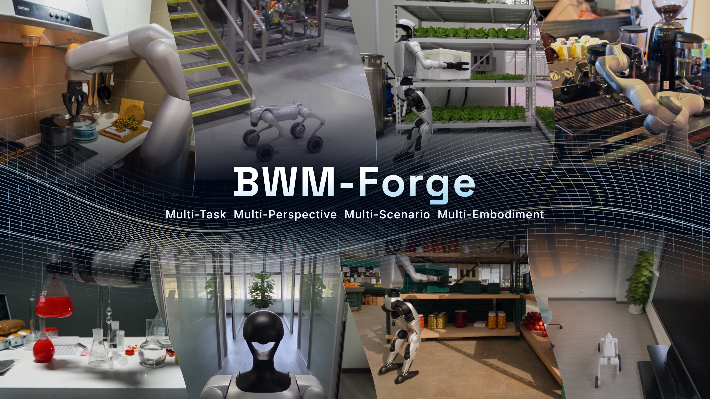
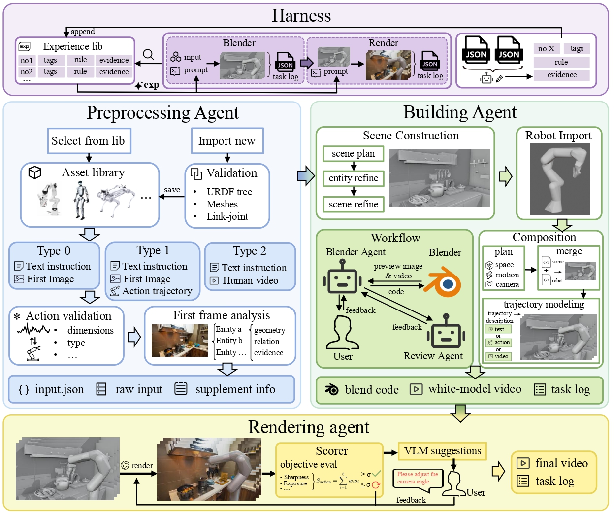

<h1 align="center">BWM-Forge: Agentic World Programming for Embodied Intelligence</h1>

<p align="center">
  <strong>English</strong> | <a href="README_CN.md">简体中文</a>
</p>

<div align="center">

[](https://bwm-forge.github.io/)
[]()
[](LICENSE)

</div>

<p align="center">
  
</p>

**BWM-Forge** generates controllable robot videos by *programming the world* instead of predicting pixels end to end. A coding agent writes editable Blender scene programs that specify objects, robot motion, and cameras; Blender renders them into a **proxy video**; a video generation model then adds realistic appearance on top of that structure and motion.

Because geometry, motion, and viewpoint stay explicit in code, you can move one object, swap in a different robot, or film the same interaction from a new camera without starting over. This repository provides the full pipeline and a local Gradio workspace that brings input processing, Blender modeling, video generation, human review, and a reusable experience store together in one place.

## 📖 Contents

- [Highlights](#highlights)
- [Framework](#framework)
- [Demo](#demo)
- [Quick Start](#quick-start)
- [User Guide](#user-guide)
- [Contributors](#contributors)
- [Citation](#citation)
- [License](#license)

---

<a id="highlights"></a>

## 🌟 Highlights

- **Three paradigms**: Generate motion from spatial semantics, motion priors, or real demonstrations.
- **Multiple embodiments**: Support robot arms, humanoids, robot dogs, and dexterous hands, with local URDF import including mesh resources.
- **Staged, editable modeling**: Scene, robot, and composed animation are built as separate Blender stages. Every round keeps its `.blend` project, scripts, and previews, so results are revised rather than regenerated.
- **Viewpoint control** Ask for a new camera in a revision while the scene layout, robot pose, and animation stay fixed, or reload a finished task to film it from another view.
- **Evaluate, then revise**: Generate videos from proxy videos and reference images, using local objective metrics and model-based visual evaluation to guide revisions.
- **Round tracking and experience reuse**: Modeling and rendering rules distilled from finished tasks are retrieved in later tasks.

<a id="framework"></a>

## 🧩 Framework

The app runs four stages in order: **Input → Blender (Scene → Robot → Composed) → Render → Harness**. 

<p align="center">
  
</p>

<a id="demo"></a>

## 🎬 Demo

https://github.com/user-attachments/assets/419fc098-b061-4e2d-940e-27fd8a4a3cbf

<a id="quick-start"></a>

## 🚀 Quick Start

### Prerequisites

The project is currently intended primarily for local use on Windows, with the interface and application running on the same computer.

| Dependency | Description |
| --- | --- |
| Python | Version 3.11 or later; a separate environment is recommended |
| Blender | Requires the Blender executable and its bundled Python; configure the executable path in `config.py` |
| Python packages | See [requirements.txt](requirements.txt) |
| Model services | A service supporting the Responses API, plus a video generation service compatible with the current integration |
| Cloudflared | Temporarily publishes the proxy video during Render. Place `cloudflared.exe` in `Render/tools/` from the [official releases](https://github.com/cloudflare/cloudflared/releases)|

Model requests and video generation require internet access. The full workflow uses a temporary Cloudflare tunnel to make the selected proxy video accessible to the video generation service.

### 1. Install Dependencies

After cloning or downloading the repository, run these commands from its root directory:

```bash
conda create -n bwm python=3.11 -y
conda activate bwm
python -m pip install -r requirements.txt
```

Install Blender and confirm that it launches locally. Blender is a separate application and is not included in the Python dependencies.

### 2. Configure Models and Services

Runtime settings are centralized in [config.py](config.py). Before your first run, configure at least the following:

| Setting | Purpose |
| --- | --- |
| `OPENAI_BASE_URL` | Responses API base URL, such as `https://your-provider.example/v1` |
| `OPENAI_AUTH_FILE` | Path to the credentials file shared by the general model services |
| `INPUT_MODEL` | Model for analyzing the first frame; must support image input |
| `BLENDER_MODEL` | Codex model used for Blender modeling |
| `BLENDER_EXE` | Full path to the local Blender executable |
| `RENDER_MODEL` | Model for visual video evaluation and stage summaries; must support image input |
| `HARNESS_MODEL` | Model for organizing and updating experience |
| `SEEDANCE_BASE_URL` | Video generation service base URL |
| `SEEDANCE_MODEL` | Video generation model name |
| `SEEDANCE_AUTH_FILE` | Path to the video service credentials file |

Use model names supported by your provider. Set the general model URL to the API base URL; the application appends `/responses`, so you do not need to supply the full endpoint.

By default, Input, Blender, Render, and Harness share `OPENAI_BASE_URL` and `OPENAI_AUTH_FILE`. To configure them separately, edit each stage's `*_OPENAI_BASE_URL` and `*_OPENAI_AUTH_FILE`. Restart the application after changing the configuration.

The video service uses a separate request protocol, implemented in [Render/seedance.py](Render/seedance.py). When switching providers, check that task submission, status queries, and media input formats are compatible with this implementation.

### 3. Add your API keys

Create the folder `assets/api/` with the two files below, or point `OPENAI_AUTH_FILE` and `SEEDANCE_AUTH_FILE` in `config.py` to other locations.

`assets/api/auth.json`:

```json
{ "OPENAI_API_KEY": "REPLACE_WITH_YOUR_API_KEY" }
```

`assets/api/seedance_auth.json`:

```json
{ "SEEDANCE_API_KEY": "REPLACE_WITH_YOUR_API_KEY" }
```

### 4. Launch

Run this command from the repository root:

```bash
python -m gui.app
```

Your browser opens automatically. If it doesn't, go to <http://127.0.0.1:7860>. The server listens on localhost only.

<a id="user-guide"></a>

## 🧭 User Guide

### Workflow

#### 1. Prepare Inputs

Select a robot type and asset, enter a task description, and choose an input mode:

| Mode | Required Inputs | Motion Source |
| --- | --- | --- |
| Spatial semantics | First-frame image, robot asset, task description | Motion inferred from the image and description |
| Motion priors | First-frame image, robot asset, task description, NPZ / Parquet trajectory, sampling rate | The supplied trajectory serves as a motion reference |
| Real demonstrations | Robot asset, task description, MP4 / MOV demonstration video | Motion generated from the demonstration video |

First-frame images can be PNG, JPG, or WebP. Click **Create task and run Input** to create a task.

To import an asset, select **Import local robot asset** and enter the URDF path on the computer running the application, along with an asset name. Use an expanded URDF and preserve its relative directory structure for `meshes/`, textures, and other resources. All resource references must resolve locally.

#### 2. Review Blender Results

Blender performs modeling in this order:

1. **Scene**: Build the scene and review its preview image.
2. **Robot**: Prepare the robot model and review its preview image.
3. **Composed**: Combine the scene and robot, generate motion, and review the complete proxy video.

Click **Accept and continue** to accept a result, or enter revision instructions, optionally attach reference images, and click **Submit revision**. Project files, scripts, previews, and feedback from each round are saved in the task directory.

#### 3. Generate and Confirm Videos

After Blender finishes, click **Continue generation** to start video generation manually. The application sends the proxy video and reference first frame to the video generation service, then evaluates the result. If the initial objective score falls below the configured threshold, the workflow automatically generates at most one corrected version before proceeding to full evaluation and human review.

You can reevaluate the video, request revisions, or click **Confirm final video** to confirm the result. Once confirmation and the stage summary are complete, Harness archives the results and updates the experience store.

#### 4. Continue from a past task

Click **Load historical task**, pick a task, then click **Load as new task**. This copies a finished task's Blender results into a new task and reopens the Composed review, which makes it easy to make further edits or film the scene from another camera.

A workspace runs one task at a time, and a task waiting for your review also holds that slot.

<a id="trajectory-format"></a>

### Trajectory Format

The motion priors mode accepts two file formats:

- **NPZ**: A two-dimensional real-valued array named `action`, with shape `(T, D)`.
- **Parquet**: A column named `action`, where each row contains a real-valued vector of length `D`.

All values must be finite; NaN, Inf, and object arrays are not accepted. Enter the sampling rate explicitly in the interface.

| Action Space | Columns | Units and Conventions |
| --- | --- | --- |
| `joint` | Each column corresponds to an explicitly named independent URDF joint, in the order entered in the interface | Absolute joint positions; radians for rotation and meters for translation |
| `eef` | Seven fixed columns: `x, y, z, roll, pitch, yaw, gripper` | Absolute TCP pose in the base frame; position in meters, angles in radians, rotation order `Rz @ Ry @ Rx` |

For `joint` trajectories, robot arms, humanoids, and robot dogs all require joint names in trajectory-column order: the first name corresponds to the first column, and so on. Names must match the independently movable joints in the selected asset's URDF.

`eef` is supported only for robot arms. The gripper channel uses `0` for closed and `1` for open as reference conventions; the actual mapping depends on the asset's structure and calibration.

<a id="outputs-and-experience-store"></a>

### Outputs and Experience Store

Each task is stored under `output/<task_id>/`. Its main outputs include:

| Path | Contents |
| --- | --- |
| `task.json` | Task metadata and stage status |
| `input/input.json` | Input stage handoff data |
| `blender/final.blend` | Final Blender project |
| `blender/white_model.mp4` | Final proxy video |
| `blender/run.json`, `blender/stages/` | Modeling rounds and review records |
| `render/` | Generated videos, version records, and evaluation files |
| `harness/result.json`, `harness/runs/` | Archived results, experience processing records, and reports |

Use the task records and interface to locate the final files for each version. Render revisions use distinct filenames.

The experience store defaults to `assets/experience-store/`, with JSONL files for general experience and experience applicable to specific contexts. Blender modeling rounds and Render video versions retrieve relevant experience. When a task finishes, Harness uses the stage records to determine how the store should be updated.

<a id="notes"></a>

### Notes

- Task files contain local paths and status information. Keep input files, assets, and task directories in place while the application is running.
- After modifying a URDF or mesh, delete the asset's cached `blender/robot.blend`, if present, before rebuilding the model.
- Model requests, video generation, and revisions consume your own service quota. Model capabilities, service availability, and generation time depend on your configured providers.

<a id="contributors"></a>

## 👥 Contributors

| Role | Contributors |
| :--- | :--- |
| **Project Leader** | Lanyun Zhu |
| **Core Contributors** | Chenming Li, Jianhao Song, Xuanyi Liu, Zhixuan Xu |
| **Contributors** | Yichen An, Youyuan Jiang, Haotian Zhang, Ziming Wei, Enci Xie, Hongye Fang, Yueyang Li, Zixuan Zhang, Xun Jiang, Xuancheng Xu, Zengrong Lin, Baixu Ji, Chengxing Xie, Yi Guan, Zesi Shen |
| **Corresponding Authors** | Lanyun Zhu, Xing Xu, Heng Tao Shen |

<a id="citation"></a>

## 📚 Citation

**arXiv: TODO** (paper URL and identifier to be added)

If this project is useful for your research, please consider citing the associated paper. The BibTeX entry below is a placeholder and will be updated when the paper is released.

```bibtex
@article{bwmforge,
  title   = {TODO},
  author  = {TODO},
  journal = {arXiv preprint arXiv:TODO},
  year    = {TODO},
  url     = {TODO}
}
```

<a id="license"></a>

## 📜 License

Copyright 2026 BWM-Forge contributors.

The project's original code and documentation are licensed under the [Apache License 2.0](LICENSE).
