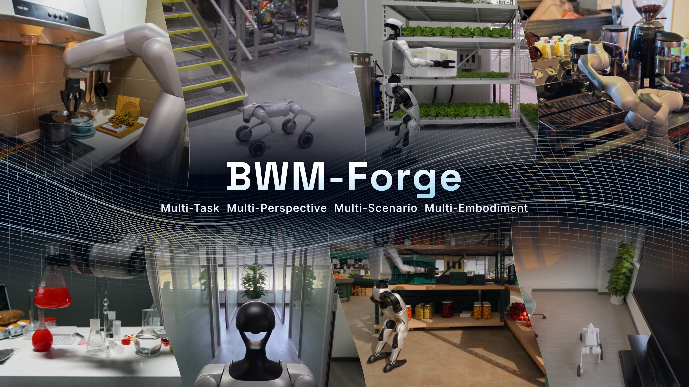
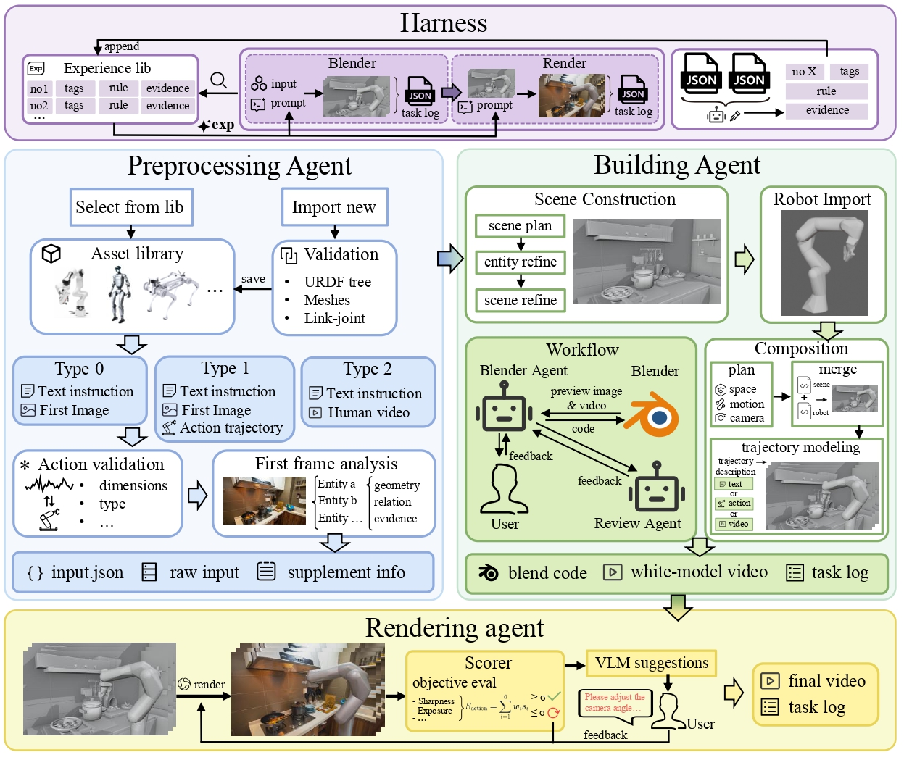

<h1 align="center">BWM-Forge: Agentic World Programming for Embodied Intelligence</h1>

<p align="center">
  <a href="README.md">English</a> | <strong>简体中文</strong>
</p>

<div align="center">

[](https://bwm-forge.github.io/)
[]()
[](LICENSE)

</div>

<p align="center">
  
</p>

BWM-Forge 从机器人资产、参考图像与动作描述生成 Blender 场景和动画，再将白模视频转换为具有真实感的视频。项目通过 Gradio 提供图形界面，将输入处理、Blender 建模、视频生成、人工审核与经验积累串成一个流程，同时保存工程文件、各轮结果和运行记录。

## 📖 目录

- [项目概览](#overview)
- [Demo](#demo)
- [快速开始](#quick-start)
- [使用指南](#usage)
- [贡献者](#authors)
- [引用](#citation)
- [许可证](#license)

---

<a id="overview"></a>

## 🌟 项目概览

- **三种范式**：空间语义驱动、运动先验驱动、真实示范驱动。
- **机器人资产库**：支持机械臂、人形机器人、机械狗与灵巧手，可导入包含网格资源的本地 URDF。
- **分阶段建模**：分别生成场景、机器人和组合动画，通过预览图与完整白模视频进行审核。
- **视频生成与评估**：使用白模视频和参考图像生成视频，结合本地客观指标与模型视觉评估提供修改依据。
- **轮次记录与经验复用**：保留各轮工程、反馈和日志；检索已有经验，并在任务结束后归档与更新经验库。

### 工作流程

`Input` → `Blender: Scene / Robot / Composed` → `Render` → `Harness`

<p align="center">
  
</p>

<a id="demo"></a>

## 🎬 Demo

https://github.com/user-attachments/assets/16f00275-e761-4145-bf54-a166538858b6

<a id="quick-start"></a>

## 🚀 快速开始

### 环境准备

当前以 Windows 本地使用为主，界面与程序运行在同一台计算机上。

| 依赖 | 说明 |
| --- | --- |
| Python | 3.11 或更高版本，建议使用独立环境 |
| Blender | 需要可执行文件及其内置 Python，路径在 `config.py` 中配置 |
| Python 依赖 | 见 [requirements.txt](requirements.txt) |
| 模型服务 | 支持 Responses API 的模型服务，以及当前代码对接的视频生成服务 |
| Cloudflared | Render 阶段用于临时发布白模视频；程序优先查找 `Render/tools/cloudflared.exe`|

模型请求和视频生成需要联网。完整流程会通过 Cloudflare 临时隧道提供所选白模视频，供视频服务读取。

### 1. 安装依赖

克隆或下载仓库后，在仓库根目录执行：

```bash
conda create -n bwm python=3.11 -y
conda activate bwm
python -m pip install -r requirements.txt
```

安装 Blender，并确认可以在本机启动。Blender 是独立安装的软件，不包含在 Python 依赖中。

### 2. 配置模型与服务

运行参数集中在 [config.py](config.py)。首次使用时至少修改以下配置：

| 配置 | 用途 |
| --- | --- |
| `OPENAI_BASE_URL` | Responses API 的根地址，例如 `https://your-provider.example/v1` |
| `OPENAI_AUTH_FILE` | 通用模型认证文件路径 |
| `INPUT_MODEL` | 首帧分析模型，需要支持图像输入 |
| `BLENDER_MODEL` | Blender 建模使用的 Codex 模型 |
| `BLENDER_EXE` | 本机 Blender 可执行文件的完整路径 |
| `RENDER_MODEL` | 视频视觉评估与阶段总结使用的模型，需要支持图像输入 |
| `HARNESS_MODEL` | 经验整理与更新使用的模型 |
| `SEEDANCE_BASE_URL` | 视频生成服务根地址 |
| `SEEDANCE_MODEL` | 视频生成模型名称 |
| `SEEDANCE_AUTH_FILE` | 视频服务认证文件路径 |

模型名称按服务商实际支持的名称填写。通用模型地址填写 API 根地址，程序会追加 `/responses`，无需填写完整请求端点。

默认情况下，Input、Blender、Render 和 Harness 共用 `OPENAI_BASE_URL` 与 `OPENAI_AUTH_FILE`。如需分别配置，可修改各阶段的 `*_OPENAI_BASE_URL` 和 `*_OPENAI_AUTH_FILE`。配置修改后需要重启程序。

视频服务使用独立的请求协议，具体接口见 [Render/seedance.py](Render/seedance.py)。更换服务商时，需要确认其提交、任务查询和媒体输入格式与当前实现兼容。

### 3. 创建认证文件

按默认路径，在 `assets/api/` 下创建以下两个文件。也可以在 `config.py` 中指定其他路径。

`assets/api/auth.json`：

```json
{
  "OPENAI_API_KEY": "REPLACE_WITH_YOUR_API_KEY"
}
```

`assets/api/seedance_auth.json`：

```json
{
  "SEEDANCE_API_KEY": "REPLACE_WITH_YOUR_API_KEY"
}
```

将占位内容替换为自己的 API Key。

### 4. 启动界面

在仓库根目录执行：

```bash
python -m gui.app
```

程序会尝试打开浏览器，也可以手动访问：

```text
http://127.0.0.1:7860
```

界面默认仅在本机监听。

<a id="usage"></a>

## 🧭 使用指南

### 🔄 使用流程

#### 1. 准备输入

选择机器人类型和资产，填写任务描述，再选择输入模式：

| 模式 | 所需输入 | 动作来源 |
| --- | --- | --- |
| 空间语义驱动 | 首帧图像、机器人资产、任务描述 | 根据图像与描述生成动作 |
| 运动先验驱动 | 首帧图像、机器人资产、任务描述、NPZ / Parquet 轨迹、采样率 | 使用提供的动作轨迹作为参考 |
| 真实示范驱动 | 机器人资产、任务描述、MP4 / MOV 演示视频 | 根据演示视频生成动画 |

首帧图像支持 PNG、JPG 和 WebP。点击 **Create task and run Input** 创建任务。

导入新资产时，选择 **Import local robot asset**，填写运行程序这台计算机上的 URDF 路径和资产名称。请使用已展开的 URDF，并保留其与 `meshes/`、纹理等资源的相对目录关系；资源引用应能在本地解析。

#### 2. 审核 Blender 结果

Blender 按以下顺序完成建模：

1. **Scene**：生成场景，审核预览图。
2. **Robot**：准备机器人模型，审核预览图。
3. **Composed**：组合场景与机器人，生成动作并审核完整白模视频。

点击 **Accept and continue** 接受当前结果，或填写修改意见、附加参考图像后点击 **Submit revision**。每轮工程、脚本、预览和反馈会保存在任务目录中。

#### 3. 生成并确认视频

Blender 完成后，点击 **Continue generation** 启动视频生成。程序使用白模视频与参考首帧请求视频生成服务，并输出评估结果。初版客观评分低于配置阈值时，流程最多自动生成一次修正版，之后进入完整评估与人工审核。

可以在界面中重新评估、提交修改，或点击 **Confirm final video** 确认最终视频。确认和阶段总结完成后，Harness 会归档结果并更新经验库。

#### 4. 从历史任务开始

界面提供历史任务入口。**Load as new task** 会复制已完成的 Blender 结果，创建一个新的任务，并回到组合动画审核，适合在已有结果上继续修改。

单个工作区一次运行一个任务，等待人工审核时也会占用执行名额。

<a id="trajectory-format"></a>

### 📐 轨迹格式

运动先验驱动模式接受以下两种文件格式：

- **NPZ**：包含名为 `action` 的二维实数数组，形状为 `(T, D)`。
- **Parquet**：包含名为 `action` 的列，每行是长度为 `D` 的实数向量。

数据必须为有限数值，不能包含 NaN、Inf 或对象数组。采样率在界面中显式填写。

| 动作空间 | 列定义 | 单位与约定 |
| --- | --- | --- |
| `joint` | 每列对应一个明确填写的 URDF 独立关节，按界面中的关节名称顺序排列 | 绝对关节位置；旋转关节为 rad，移动关节为 m |
| `eef` | 固定七列：`x, y, z, roll, pitch, yaw, gripper` | 基座坐标系下的绝对 TCP 位姿；位置为 m，角度为 rad，旋转顺序为 `Rz @ Ry @ Rx` |

使用 `joint` 轨迹时，机械臂、人形机器人和机器狗都要在界面中按轨迹数据的列顺序填写关节名：第 1 个名称对应第 1 列，以此类推。名称必须与所选资产 URDF 中可独立运动的关节名一致。

`eef` 仅用于机械臂。夹爪列以 `0` 闭合、`1` 张开作为约定参考，实际驱动映射取决于资产结构与标定信息。

<a id="outputs"></a>

### 📂 输出与经验库

#### 任务输出

每个任务保存在 `output/<task_id>/` 下，主要产物包括：

| 路径 | 内容 |
| --- | --- |
| `task.json` | 任务元数据与阶段状态 |
| `input/input.json` | 输入阶段交接数据 |
| `blender/final.blend` | 最终 Blender 工程 |
| `blender/white_model.mp4` | 最终白模视频 |
| `blender/run.json`、`blender/stages/` | 建模轮次与审核记录 |
| `render/` | 生成视频、版本记录及评估文件 |
| `harness/result.json`、`harness/runs/` | 归档结果、经验处理记录及报告 |

建议通过任务记录和界面查看各版本的最终路径；Render 的修改版本会使用独立文件名。

#### 经验库与提示词

经验库默认位于 `assets/experience-store/`，以 JSONL 文件保存通用经验和特定范围的经验。Blender 建模轮次与 Render 视频版本会检索经验，Harness 在任务结束后根据阶段记录生成经验更新决策。

<a id="notes"></a>

### 📌 使用说明

- 任务文件包含本机路径和状态信息，运行中请保留输入、资产与任务目录的位置。
- 修改 URDF 或网格后，如资产目录中已有 `blender/robot.blend`，请删除对应缓存后重新建模。
- 模型请求、视频生成和修改会使用用户自己的服务额度。具体模型能力、服务可用性及生成耗时取决于所配置的服务商。

<a id="authors"></a>

## 👥 贡献者

| Role | Contributors |
| :--- | :--- |
| **Project Leader** | Lanyun Zhu |
| **Core Contributors** | Chenming Li, Jianhao Song, Xuanyi Liu, Zhixuan Xu |
| **Contributors** | Yichen An, Youyuan Jiang, Haotian Zhang, Ziming Wei, Enci Xie, Hongye Fang, Yueyang Li, Zixuan Zhang, Xun Jiang, Xuancheng Xu, Zengrong Lin, Baixu Ji, Chengxing Xie, Yi Guan, Zesi Shen |
| **Corresponding Authors** | Lanyun Zhu, Xing Xu, Heng Tao Shen |

<a id="citation"></a>

## 📚 引用

**arXiv：TODO**（论文链接与编号待补充）

如果本项目对你的研究有所帮助，欢迎引用相关论文。以下 BibTeX 为占位内容，待论文发布后更新。

```bibtex
@article{bwmforge,
  title   = {TODO},
  author  = {TODO},
  journal = {arXiv preprint arXiv:TODO},
  year    = {TODO},
  url     = {TODO}
}
```

<a id="license"></a>

## 📜 许可证

Copyright 2026 BWM-Forge contributors.

本项目的原创代码与文档采用 [Apache License 2.0](LICENSE)。
